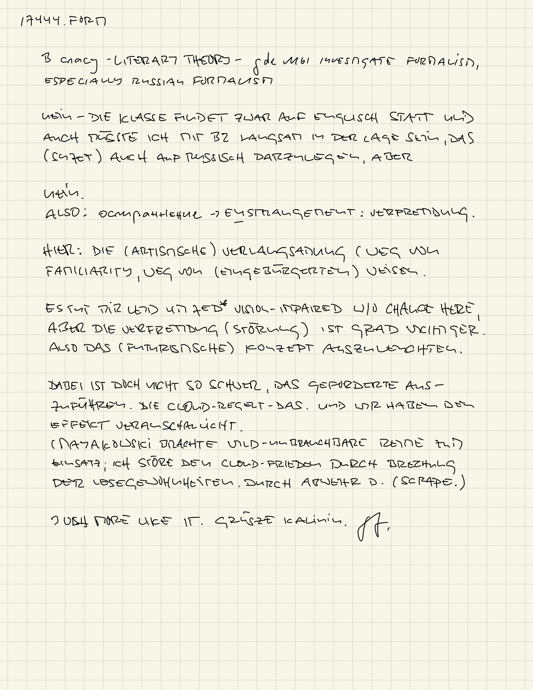

::: {.content-visible when-format="html"}

:::
 
::: {.content-visible when-format="html"}

-----

> [THEORY](index.qmd) / ostrannenie

-----
:::
```{r,echo=F,eval=T}
print("engine on...")
#val <- quarto::quarto_metadata$get("meta")
#meta <- knitr::metadata
#params <- meta$
#val<-params$tmeta
val.f<-"fixed val"
val.c<-""
val.c<-""
```


<figure>
  
  <figcaption>17444.: die cloud entfremden.</figcaption>
</figure>


# references

